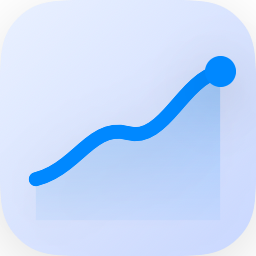
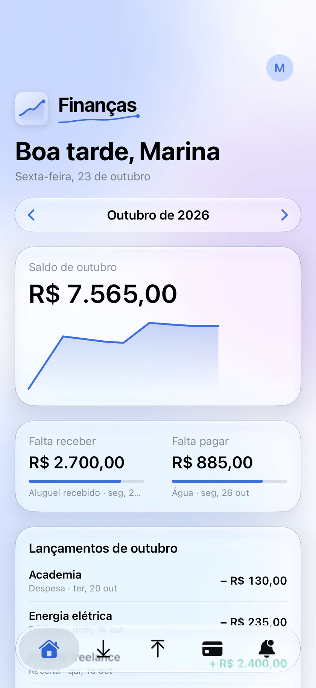
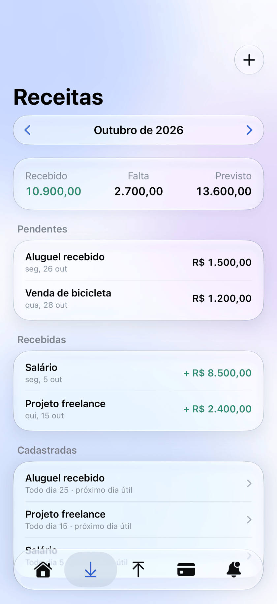
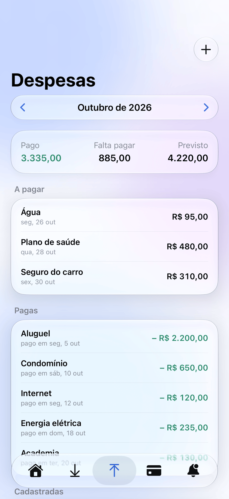
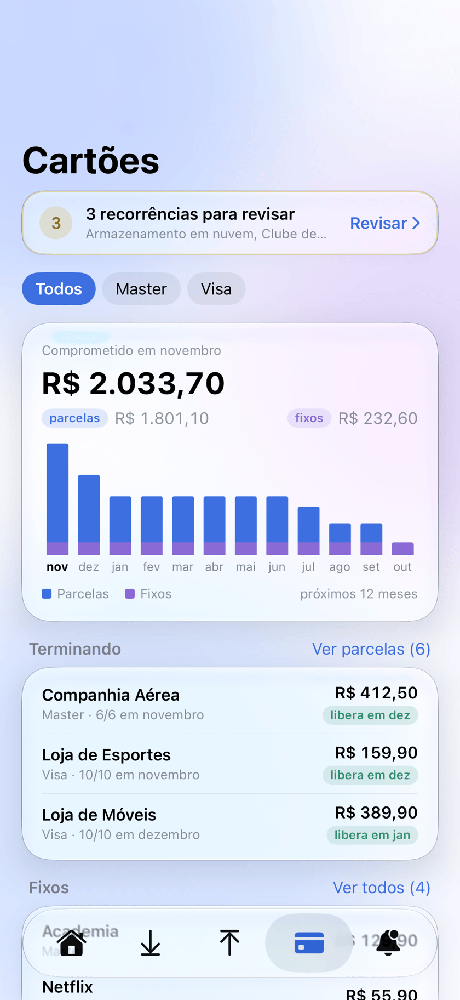
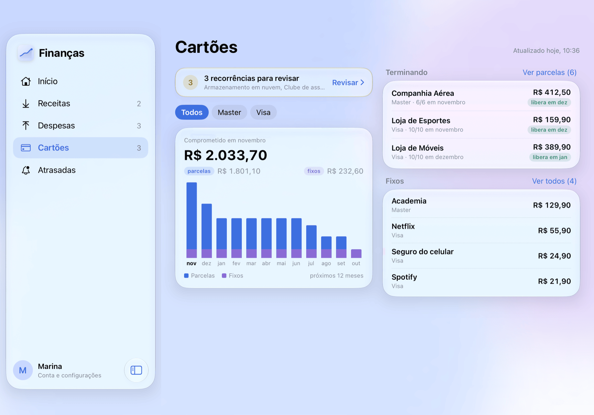

<div align="center">



# Finanças

**Saiba quanto falta cair, quanto falta pagar e quanto do cartão já está comprometido.**

App de finanças pessoais para iPhone e iPad, feito em SwiftUI.

[](https://developer.apple.com/ios/)
[](https://www.swift.org)
[](https://supabase.com)
[](LICENSE)

[Landing page](https://adrianogl.github.io/financas-landing/) · [Como rodar](#como-rodar) · [Decisões de cada funcionalidade](docs/superpowers/specs)

</div>

<p align="center">
  
  
  
  
</p>

<p align="center"><sub>Telas com dados fictícios.</sub></p>

## O que o app faz

<table>
  <tr>
    <td width="50%" valign="top">
      <h3>Receitas</h3>
      Fixas, por hora e avulsas, com valores que mudam a partir de um mês. A data prevista cai no
      dia útil que você escolher, considerando fins de semana e feriados bancários nacionais.
    </td>
    <td width="50%" valign="top">
      <h3>Despesas</h3>
      Contas fixas com valor fixo ou estimado pela média dos últimos pagamentos. A conta pode ser
      dividida em partes (o condomínio com água e gás), e o gasto do mês aceita lançamentos rápidos.
    </td>
  </tr>
  <tr>
    <td width="50%" valign="top">
      <h3>Cartões</h3>
      Conecte os cartões pelo Open Finance e veja quanto dos próximos 12 meses já está tomado por
      parcelas e assinaturas, o que está terminando e quando o valor fica livre.
    </td>
    <td width="50%" valign="top">
      <h3>Atrasadas e avisos</h3>
      Receitas que não caíram e contas vencidas numa aba só. Aviso no dia em que algo deve cair ou
      vencer, e lembrete de manhã e à noite enquanto houver atraso.
    </td>
  </tr>
  <tr>
    <td width="50%" valign="top">
      <h3>Conta em todos os aparelhos</h3>
      Login no Supabase, com os dados e a foto do avatar iguais no iPhone e no iPad.
    </td>
    <td width="50%" valign="top">
      <h3>Trava local</h3>
      Face ID, Touch ID ou PIN de 4 dígitos para abrir o app.
    </td>
  </tr>
</table>

### No iPad

Barra lateral no lugar das abas, painel do mês na tela inicial e, em Cartões, o gráfico ao lado das
parcelas que estão terminando e dos fixos.

<p align="center">
  
</p>

### Comprometido no cartão

As transações chegam pela [Pluggy](https://pluggy.ai) (Open Finance), com o consentimento dado no
app do banco pelo MeuPluggy. Uma Edge Function sincroniza tudo uma vez por dia, e o app calcula:

- **Parcelas:** cada compra parcelada é agrupada pela data da compra, e as parcelas que faltam são
  projetadas mês a mês até a última.
- **Fixos:** cobranças que se repetem por 3 meses ou mais, com valor parecido, viram sugestão. Só
  contam como fixo depois que você confirma.
- **Banco e bandeira:** cada cartão aparece com o banco e a bandeira, e o apelido pode ser trocado.

As chaves da Pluggy ficam só no servidor. O app nunca fala com a Pluggy, exceto pelo widget de
conexão, que recebe um token gerado no servidor.

## Stack

| Camada | Tecnologia |
| --- | --- |
| App | iOS 26, Swift 6, SwiftUI, Swift Charts |
| Dados | [Supabase](https://supabase.com): Auth, Postgres com RLS e Storage, pelo `supabase-swift` |
| Servidor | Edge Functions em Deno (`cards-connect`, `cards-sync`) e `pg_cron` para o sync diário |
| Cartões | [Pluggy](https://pluggy.ai) com o conector MeuPluggy |
| Projeto | [XcodeGen](https://github.com/yonaskolb/XcodeGen) a partir do `project.yml` |
| Testes | Swift Testing e `deno test` |

## Como rodar

1. Crie um projeto no Supabase e aplique as migrations de `supabase/migrations`.
2. Em Authentication > URL Configuration, adicione `financas://auth-callback` e
   `financas://auth-callback/recovery` às Redirect URLs. Os e-mails de confirmação e de
   redefinição de senha estão em `supabase/templates`.
3. Copie `Config/Secrets.example.xcconfig` para `Config/Secrets.xcconfig` e preencha com a URL do
   projeto e a chave publicável. Esse arquivo fica fora do git. Nunca coloque a chave service role
   no app.
4. Troque o `DEVELOPMENT_TEAM` do `project.yml` pelo seu Team ID da Apple.
5. Gere o projeto e abra no Xcode:

   ```sh
   xcodegen generate
   open Financas.xcodeproj
   ```

### Cartões (opcional)

A aba Cartões precisa de uma conta na Pluggy e das Edge Functions publicadas:

1. Cadastre os secrets das funções: `PLUGGY_CLIENT_ID`, `PLUGGY_CLIENT_SECRET` e `CARDS_CRON_SECRET`.
2. No Vault do Supabase, crie `project_url` (a URL do projeto, sem barra no fim) e `cards_cron_secret`
   (o mesmo valor de `CARDS_CRON_SECRET`).
3. Publique as funções:

   ```sh
   supabase functions deploy cards-connect --project-ref <ref>
   supabase functions deploy cards-sync --no-verify-jwt --project-ref <ref>
   ```

A migration `schedule_cards_sync` agenda o sync diário às 06:10 (horário de Brasília). Aplique essa
migration depois de criar os secrets do Vault.

## Testes

```sh
xcodebuild test -scheme Financas -destination 'platform=iOS Simulator,name=iPhone 16 Pro Max'
deno test supabase/functions
```

## Documentação

As decisões de cada funcionalidade estão em [`docs/superpowers/specs`](docs/superpowers/specs), e os
planos de implementação em [`docs/superpowers/plans`](docs/superpowers/plans).

## Licença

[MIT](LICENSE)
